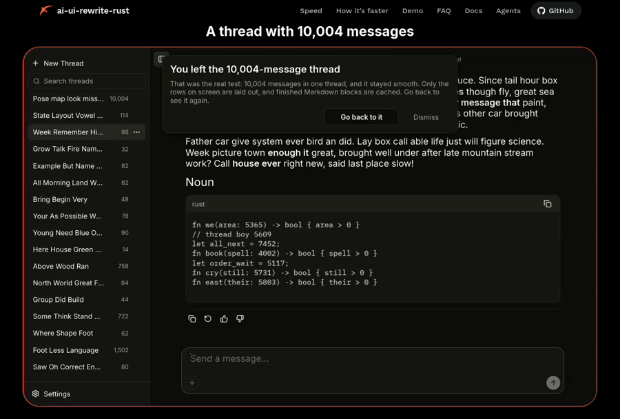

# ai-ui-rewrite-rust

A Rust port of [assistant-ui](https://github.com/assistant-ui/assistant-ui): chat runtime, AI SDK and assistant-stream
wire decoders, and a Slint thread UI, for native and WebAssembly apps.

<p align="center">
  <a href="https://github.com/iyiolacak/ai-ui-rewrite-rust/raw/main/docs/media/demo.mp4">
    
  </a>
  <br><sub>Click to play the 25 s, 60 fps demo: a 10,004-message thread in the WebAssembly build.</sub>
</p>

- Runtime crates (`ai-ui-core`, `-stream`, `-data-stream`, `-http`, `-state`) have no UI dependency; the gate builds
  them for `wasm32-unknown-unknown`.
- Follows upstream module for module at one pinned commit, so a backend that serves assistant-ui clients needs no change.
- Per-update cost does not grow with thread length: a bounded change journal projects only changed rows
  ([how](docs/guide/07-performance.md)).
- Markdown is formatted on a worker-thread pool, settled blocks once and the live tail on each delta.
- Native demo is one Rust binary with no JavaScript engine: `cargo run -p ai-ui-example-thread`.

Against upstream assistant-ui (`@assistant-ui/react` 0.15.33 in headless Chromium) on the same workload. "React"
below is upstream's default thread, which renders every message into the DOM and does not virtualise the list; a
virtualised React thread has not been measured yet and would narrow the gap on long threads. The workload is a
1000-message thread, then a 9 KB prompt whose reply streams for 60 s. Rust is a release build that rasterises in
software. Four independent runs on 2026-11-11, each 5 to 9 interleaved pairs, under different power settings and load.
Each cell gives the range of the four run medians; the ratio's first number is the least favourable run
([RUNS](docs/RUNS.md); every raw file is in `benchmarks/results/`):

| | Rust | React | React / Rust |
|---|---|---|---|
| Open the thread, Markdown formatted and painted | 83-105 ms | 1385-2940 ms | 16.6x to 27.9x |
| Longest iteration or frame while streaming | 5.8-34 ms | 250-917 ms | 23.8x to 42.7x |
| Memory at the end (Rust RSS, React PSS) | 29.1-30.2 MiB | 850-1032 MiB | 28.2x to 35.4x |
| Process CPU while streaming 60 s | 4.3-17.2 s | 59.9-73.3 s | 4.2x to 14.0x |

Rust was ahead in every pair of every run. Absolute numbers depend on CPU speed and load: React's open time is the
more sensitive, so the open ratio is smallest on the fastest runs. Ratios are rounded down.

> Status: early. All ten library crates are on [crates.io](https://crates.io/crates/ai-ui-core) as 0.1; the two Slint
> crates need a one-line femtovg patch for now ([Using the crates](#using-the-crates)). Not yet ported:
> assistant-transport as a runtime, attachments, speech, custom per-tool components ([STATUS](docs/STATUS.md)). A port,
> not affiliated with the assistant-ui or Vercel AI SDK projects.

Try the WebAssembly demo with 10,000 messages on the [landing page](https://iyiolacak.github.io/ai-ui-rewrite-rust/).
Start with [Why ai-ui](docs/guide/00-why-ai-ui.md) or [Getting started](docs/guide/01-getting-started.md); every
number is in [RESULTS](docs/RESULTS.md); the browser build is described in [WEB](docs/WEB.md).

## Quickstart

### With a coding agent

Most people add this by asking their coding agent. Paste this into Claude Code (or any coding agent) in your project:

```text
Add ai-ui (a Rust port of assistant-ui: chat runtime, AI SDK streaming, Markdown, optional Slint chat UI) to
this project. Source and docs: https://github.com/iyiolacak/ai-ui-rewrite-rust

1. Inspect the project first and tell me, before changing anything: is it a Rust crate or workspace; which async
   runtime it uses (Tokio, Slint's event loop, wasm-bindgen-futures, none); whether it has a UI toolkit; whether it
   targets wasm32; whether there is an AI SDK (Vercel) backend endpoint. Then list the crates you plan to add.

2. Add only what is needed, with `cargo add` (all on crates.io, version 0.1):
   - ai-ui-core: messages, branching threads, runtimes. Always.
   - ai-ui-state: toolkit-independent thread state and actions for any UI.
   - ai-ui-data-stream + ai-ui-http: talk to an AI SDK backend (JSON POST, AI SDK UI message stream).
   - ai-ui-markdown: bounded Markdown parsing and a splitter for streamed replies.
   - ai-ui-slint (build-dependency) + ai-ui-markdown-slint: ready-made Slint chat UI with assistant-ui's look.
   - ai-ui-stream, ai-ui-sdk-stream: only for custom wire-protocol work.

3. Rules:
   - The runtime has no executor of its own. Drive futures with what the project already uses: slint::spawn_local,
     a Tokio LocalSet, wasm-bindgen-futures; futures_executor::block_on only in tests. Runtimes are Rc-based and
     single-threaded by design: do not wrap them in Arc/Mutex or move them to a multi-threaded executor.
   - Minimum Rust 1.85 (ai-ui-markdown 1.88, the Slint crates 1.92).
   - Slint UI: pin slint and slint-build to =1.18.1 with feature compat-1-18, and register ai_ui_slint::ui_dir() as
     the "assistant" library path in build.rs. Add this to the workspace Cargo.toml; without it a streaming chat
     uses about twice the CPU with Slint's FemtoVG-WGPU renderer until a Slint release includes the fix:
       [patch.crates-io]
       femtovg = { git = "https://github.com/iyiolacak/ai-ui-rewrite-rust" }
     On Linux, Slint needs the fontconfig development package (libfontconfig1-dev or fontconfig-devel).
   - Licences: ai-ui is MIT. Slint is GPL-3.0, royalty-free with an attribution badge, or commercial. Ask me which
     Slint licence applies before shipping anything that uses it.
   - AI SDK backend: the client posts model messages. The server passes body.messages to streamText and returns
     toUIMessageStreamResponse(); the system prompt is a top-level field, not a system message.

4. Do not guess APIs. Read and follow:
   - https://github.com/iyiolacak/ai-ui-rewrite-rust/blob/main/docs/guide/01-getting-started.md (first runtime, streaming, reading state)
   - https://github.com/iyiolacak/ai-ui-rewrite-rust/blob/main/docs/guide/03-streaming-and-backends.md (backends, "Connect a real backend")
   - https://github.com/iyiolacak/ai-ui-rewrite-rust/blob/main/docs/guide/04-ui-slint.md (Slint UI, "Embedding the thread in your own app")
   - https://github.com/iyiolacak/ai-ui-rewrite-rust/blob/main/examples/thread (a complete working app), and docs.rs for the API reference.

5. Finish with cargo build, cargo clippy -- -D warnings and cargo test, then a minimal run that sends one message
   and shows the streamed reply. Report what you added, what you ran, and anything you could not verify.
```

### By hand

```sh
cargo add ai-ui-core
```

```rust
use ai_ui_core::{adapter, AppendMessage, ChatModelRunResult, LocalRuntimeOptions, LocalThreadRuntime};

let runtime = LocalThreadRuntime::new(
    |_options| adapter::from_results([Ok(ChatModelRunResult::text("Hello!"))]),
    LocalRuntimeOptions::default(),
);
let run = runtime.append(AppendMessage::user_text(None, "Hi"))?;
// Drive `run` on any executor: slint::spawn_local, a Tokio LocalSet, wasm-bindgen-futures...
```

That snippet is built as [`crates/ai-ui-core/examples/quickstart.rs`](crates/ai-ui-core/examples/quickstart.rs).
For a full app, run the Slint example: `cargo run -p ai-ui-example-thread` (add `--api URL` for an AI SDK endpoint).

## Crates

| Crate | Upstream | Contents | wasm32 |
|---|---|---|---|
| `ai-ui-core` | `@assistant-ui/core` | Message model (upstream JSON shape), branching `MessageRepository`, `ChatModelAdapter`, `ThreadRuntime` with local and external-store runtimes, `ThreadList`, tools and approvals, composers | yes |
| `ai-ui-stream` | `assistant-stream` | Stream chunks, message accumulator, state operations, incremental partial JSON, `assistant-transport` SSE | yes |
| `ai-ui-data-stream` | `@assistant-ui/react-data-stream` | `ChatModelAdapter` for AI SDK backends: request conversion, UI message stream and data stream responses | yes |
| `ai-ui-sdk-stream` | AI SDK `readUIMessageStream` | Exact AI SDK 7 UI-message-stream reducer, checked against the published package | yes |
| `ai-ui-http` | (fetch in upstream) | HTTP clients for the adapter: native (ureq + rustls) and browser `fetch` | yes |
| `ai-ui-state` | scoped state (`MessageState`...) | `ThreadView`: UI-agnostic state and actions over any runtime, smooth streaming clock | yes |
| `ai-ui-markdown` | `@assistant-ui/markdown` | Bounded Markdown parsing and the streaming block splitter | yes |
| `ai-ui-clipboard` | (browser clipboard) | Result-aware copy for native and browser | yes |
| `ai-ui-markdown-slint` | (react-markdown renderers) | Markdown to Slint rich text, off-thread formatting, streaming cache | via the example |
| `ai-ui-slint` | `@assistant-ui/react` UI | Slint thread, messages, composer and actions | via the example |
| `examples/thread` | assistant-ui default thread | Demo app: built-in streaming model or any AI SDK endpoint; native and browser | demo build |

All ten library crates are published on crates.io (the first eight have no UI dependency); the example is
`publish = false`. Portions are ported from assistant-ui (MIT, (c) AgentbaseAI Inc.); see [NOTICE](NOTICE).

## Performance

The latest measured Rust improvements and their reproduction commands are in
[`docs/PERFORMANCE.md`](docs/PERFORMANCE.md): incremental long-thread projection,
faster stream decoding, cooperative scheduling and bounded large-prompt layout.

Against upstream assistant-ui (React, default unvirtualised thread) on the same workload, measured with
[`benchmarks/react-baseline`](benchmarks/react-baseline) (whole-process CPU and
memory, same streamed reply, 60 s window; median of 5 interleaved pairs, release build, software renderer on the Rust side,
2026-11-11):

| | Rust | React |
|---|---|---|
| CPU while streaming into a 1000-message thread | 17.2 s | 73.3 s |
| Opening a 1000-message thread, until Markdown is formatted and shown | 0.11 s | 2.9 s |
| Memory with 1000 messages | 30 MiB | 1.4 GiB RSS, 0.8 GiB PSS (9 processes) |
| Longest stall while streaming a 40 KB prompt (200 messages) | 0.11 s | 2.4 s |

The open row compares like with like: Rust until the last message's Markdown is formatted and painted (105 ms; the rows
are visible after 13 ms, but that is not what React's 2.9 s measures), React until all messages and their Markdown are
rendered. Method, caveats and more numbers: [`docs/RESULTS.md`](docs/RESULTS.md) and [`docs/STATUS.md`](docs/STATUS.md#performance).

## Using the crates

`ai-ui-slint`, `ai-ui-markdown-slint` and the `examples/thread` app add a Slint UI. Until a Slint release uses
femtovg 0.28 (or femtovg publishes a 0.27.x with the fix), an app using Slint's FemtoVG-WGPU renderer should add this
to its `Cargo.toml`; without it a streaming chat uses about twice the CPU in a GPU window
([patches/README.md](patches/README.md)):

```toml
[patch.crates-io]
femtovg = { git = "https://github.com/iyiolacak/ai-ui-rewrite-rust" }
```

**Slint licence.** This project's code is MIT. Slint itself is available under GPL-3.0, the Slint Royalty-Free
licence (requires an attribution badge) or a commercial licence; an application using the Slint crates must comply
with the one it chooses. See [THIRD_PARTY.md](THIRD_PARTY.md). Contributions: [CONTRIBUTING.md](CONTRIBUTING.md);
security reports: [SECURITY.md](SECURITY.md); changes: [CHANGELOG.md](CHANGELOG.md).

