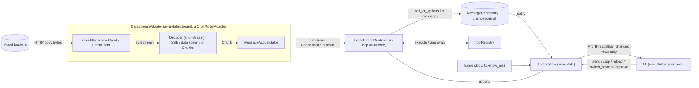

# Concepts

**What this page gives you.** This page defines the types you will use: messages and parts, the branching repository, `ThreadRuntime`, adapters, tools and approvals, smooth streaming and `ThreadView`. For each it says where the code lives and why it has that shape.

This page walks through the ideas the rest of the guide builds on, in the order data moves: a message, the tree of
messages, the runtime that owns the tree, the adapter that produces model output, tools, smooth streaming, and finally
the state layer a UI reads. Each section says what the thing is, where it lives, and why it is shaped that way. Two goals
explain most of the shapes:

- **Correctness against upstream.** Types and behaviours follow [assistant-ui](https://github.com/assistant-ui/assistant-ui)
  at one pinned commit, and tests are ported from upstream's, so a thread, a backend or a stored history means the same
  thing in both worlds.
- **Cost per streamed update.** A chat spends most of its life receiving one small update after another. The design keeps
  the work for one update independent of how long the thread is, wherever it can. It is not there yet: the runtime
  snapshot and state projection still grow with history ([Performance](07-performance.md)).

## The message model

Types live in [`crates/ai-ui-core/src/types.rs`](https://github.com/iyiolacak/ai-ui-rewrite-rust/blob/main/crates/ai-ui-core/src/types.rs).
A `ThreadMessage` is one of three roles (`MessageRole`): `System`, `User` or `Assistant`.

| Role | Struct | Content parts (`type` tag) |
|---|---|---|
| System | `SystemMessage` | `text` |
| User | `UserMessage` | `text`, `image`, `file`, `data`, `audio`, plus `attachments` |
| Assistant | `AssistantMessage` | `text`, `reasoning`, `tool-call`, `source`, `file`, `image`, `data`, `generative-ui` |

Only assistant messages have a `status` (`MessageStatus`), because only they are produced over time:

- `Running`: the run is in progress.
- `RequiresAction { reason }`: paused until the app or the user acts, for tool calls or an interrupt.
- `Complete { reason }`: finished, with `Stop` or `Unknown`.
- `Incomplete { reason, error }`: ended early, because it was cancelled, hit a length or content filter, reached the step
  limit with tool calls pending, or failed (`Error`, with the error detail stored on the message).

Parts have their own `PartStatus` (`Running`, `Complete`, `Incomplete`). That is how a UI knows which paragraph is still
growing. A tool call is a part (`ToolCallPart`) that carries its arguments (`args` parsed, `args_text` raw), its `result`,
`is_error`, an optional `approval` and an optional `interrupt`, so a call and its answer live in one place.

Two design choices matter here.

**The JSON shape is upstream's.** Tags are `type` and `role`, field names are camelCase, `createdAt` is epoch
milliseconds, and fields this port does not model are kept in an `extra` map and written back out. A message exported
from one side imports on the other, and a backend that expects assistant-ui's message JSON does not need to know which
client sent it.

**Messages are shared, not copied.** The thread hands out `Arc<ThreadMessage>`. A streamed update replaces one `Arc`;
every other message keeps its pointer, which is what the state layer later uses to skip unchanged rows.

## The branching repository

`MessageRepository` ([`repository.rs`](https://github.com/iyiolacak/ai-ui-rewrite-rust/blob/main/crates/ai-ui-core/src/repository.rs))
stores a conversation as a tree, because a conversation with edit and regenerate is not a list. Each message has one
`parent_id` (`None` for a root). Messages that share a parent are *siblings*, and each parent remembers which child is
selected. The *head* is the last message of the *selected path* that runs from the root through the selected children.
`messages()` returns that path, and it is what the UI shows and what is sent to the model.

Branches are created by two operations, and both are ordinary appends under an existing parent:

- **Regenerate** answers the same user message again. Call `start_run` with `parent_id` set to the user message and
  `source_id` set to the answer being replaced. The new answer becomes a sibling of the old one and is selected.
- **Edit** replaces a user message. Append a user message with the edited message's parent and `source_id` set to the
  edited message. The edited text becomes a sibling of the original, and its answer follows it. A `Composer` from
  `begin_edit` does this for you when you `send` it.

`switch_to_branch(id)` selects the branch containing `id`, and `branches(id)` lists a message and its siblings.
`branch_position(id)` gives the 1-based position and count that a "2 / 3" branch picker shows.

```rust
use ai_ui_core::{
    adapter, AppendMessage, ChatModelRunResult, LocalRuntimeOptions, LocalThreadRuntime,
    StartRunConfig, ThreadRuntime,
};
use std::cell::Cell;
use std::rc::Rc;

fn main() -> Result<(), Box<dyn std::error::Error>> {
    let calls = Rc::new(Cell::new(0));
    let runtime = LocalThreadRuntime::new(
        {
            let calls = calls.clone();
            move |_options| {
                calls.set(calls.get() + 1);
                adapter::from_results([Ok(ChatModelRunResult::text(format!(
                    "answer {}",
                    calls.get()
                )))])
            }
        },
        LocalRuntimeOptions::default(),
    );
    futures_executor::block_on(runtime.append(AppendMessage::user_text(None, "Hi"))?)?;
    let user = runtime.messages()[0].id().clone();
    let first = runtime.messages()[1].id().clone();

    // Regenerate: answer the same user message again, replacing `first` on the selected path.
    futures_executor::block_on(runtime.start_run(StartRunConfig {
        parent_id: Some(user.clone()),
        source_id: Some(first.clone()),
        ..Default::default()
    })?)?;
    println!("selected: {}", runtime.messages()[1].text());
    println!("siblings: {}", runtime.branches(&first)?.len());

    // Edit: append a user message with the same parent and a source_id.
    let mut edit = AppendMessage::user_text(None, "Hello");
    edit.source_id = Some(user.clone());
    futures_executor::block_on(runtime.append(edit)?)?;
    println!(
        "after edit: {:?}",
        runtime
            .messages()
            .iter()
            .map(|m| m.text())
            .collect::<Vec<_>>()
    );

    // Go back to the first answer's branch.
    runtime.switch_to_branch(&first)?;
    println!(
        "after switch: {:?}",
        runtime
            .messages()
            .iter()
            .map(|m| m.text())
            .collect::<Vec<_>>()
    );

    // Persist and restore.
    let saved = ThreadRuntime::export(&runtime);
    println!("exported {} messages", saved.messages.len());
    Ok(())
}
```

This prints:

```text
selected: answer 2
siblings: 2
after edit: ["Hello", "answer 3"]
after switch: ["Hi", "answer 1"]
exported 5 messages
```

The edit left the first branch intact: switching back to the original answer restores the original question too.
`export()` returns an `ExportedRepository` (every message with its parent, plus the head) and `import()` loads one, so a
history with all its branches survives a restart. Messages serialize with serde, so storage is up to you.
`ExportedRepository::from_linear` builds one from a plain list.

Errors that would corrupt the tree (a missing parent, a cycle) are `RepositoryError` values and leave the tree unchanged.
Upstream throws for these.

*Why a tree.* Edit and regenerate must never destroy what was there, and the model must only see the selected path. A
tree gives both for free. *Why this implementation.* Appending under the head is constant time, the selected path is cached
as one shared slice and patched in place when a streamed message replaces the head, and a bounded change journal records
which path indices changed (`message_changes_since`) plus a `shape_version` that only moves when messages are added,
moved or removed or the selection changes. Those two counters are what let a view of a long thread skip the messages that
did not change; see [the state layer](#the-state-layer) below.

## The ThreadRuntime trait

A UI never talks to a concrete runtime. It talks to the `ThreadRuntime` trait
([`runtime.rs`](https://github.com/iyiolacak/ai-ui-rewrite-rust/blob/main/crates/ai-ui-core/src/runtime.rs)):
`messages`, `is_running`, `capabilities`, `branches`, `switch_to_branch`, `append`, `reload`, `cancel_run`,
`add_tool_result`, `respond_to_tool_approval`, `submit_feedback`, composers, `subscribe_dyn`, `export` and `import`, plus
the two change counters from the previous section. `RuntimeCapabilities` says which of these the thread supports, so a
UI hides the edit button when `edit` is false instead of showing a button that fails.

Methods do their synchronous work at once and return a `RunFuture` for anything that must wait. They never spawn:
spawning belongs to your executor. The runtime is single-threaded (`Rc`) like upstream's UI-thread runtime, while
messages are `Arc` so an adapter can move them to a worker thread. Timestamps and ids come from `LocalRuntimeOptions`
(`clock`, `ids`), because `SystemTime` does not exist on `wasm32-unknown-unknown`.

There are three implementations, and one trait means the same UI works with all of them.

**`LocalThreadRuntime`**: the library drives the model. You give it a `ChatModelAdapter`, and it owns the run loop, the
repository, tools and composers. The examples in this guide use it.

**`ExternalStoreRuntime`**: your app owns the messages, the model call and the persistence, and the runtime displays them.
It is the Rust counterpart of upstream's `useExternalStoreRuntime`. You implement `ExternalStore` (`on_new`, and
optionally `on_edit`, `on_reload`, `on_cancel`, `on_add_tool_result`, `on_respond_to_tool_approval`, `on_feedback`,
`on_branch_change`), declare `capabilities`, and push state in with `set_messages`, `set_repository` and `set_running`.
Nothing is inserted optimistically. Messages you re-send unchanged keep their `Arc`, so an app that stores its own
messages does not make the view re-render the whole thread.

```rust
use ai_ui_core::{
    AppendMessage, ExternalStore, ExternalStoreRuntime, RuntimeCapabilities, StoreFuture,
    ThreadMessage, ThreadRuntime,
};
use std::cell::RefCell;
use std::rc::Rc;

/// The app owns the messages; the runtime only shows them and forwards actions.
struct App {
    sent: Rc<RefCell<Vec<String>>>,
}

impl ExternalStore for App {
    fn on_new(&self, message: AppendMessage) -> StoreFuture {
        // Send it to your own backend here, then call `set_messages` with the new state.
        if let ai_ui_core::AppendContent::User { content, .. } = &message.content {
            self.sent
                .borrow_mut()
                .push(format!("{} part(s)", content.len()));
        }
        Box::pin(async { Ok(()) })
    }
    fn capabilities(&self) -> RuntimeCapabilities {
        RuntimeCapabilities {
            switch_to_branch: true,
            copy: true,
            cancel: true,
            edit: false,
            reload: false,
            feedback: false,
            answer_tool_call: false,
        }
    }
}

fn main() -> Result<(), Box<dyn std::error::Error>> {
    let sent = Rc::new(RefCell::new(Vec::new()));
    let runtime = ExternalStoreRuntime::new(App { sent: sent.clone() });
    let hello: ThreadMessage = serde_json::from_value(serde_json::json!({
        "role": "user", "id": "m1", "createdAt": 0,
        "content": [{ "type": "text", "text": "Hello" }]
    }))?;
    runtime.set_messages([hello]);
    futures_executor::block_on(runtime.append(AppendMessage::user_text(None, "More"))?)?;
    println!(
        "{} message(s) shown, {:?} sent",
        runtime.messages().len(),
        sent.borrow()
    );
    Ok(())
}
```

**`ThreadList`**: many threads, one of them the main thread. Its factory creates one runtime per thread, so a list can mix
local and external-store threads. Switching, creating, renaming, archiving and deleting apply immediately and are
persisted by background tasks through an optional `ThreadListAdapter` (`list`, `initialize`, `rename`, `archive`,
`unarchive`, `delete`, `generate_title`, `load`); a failed task undoes its change and the message is available from
`last_error`. A new thread becomes a regular one when its first message appears. The host supplies a `Spawner` for the
background tasks. `ThreadView::for_list` follows the main thread and rebinds when it changes.

```rust
use ai_ui_core::{
    adapter, AppendMessage, ChatModelRunResult, LocalRuntimeOptions, LocalThreadRuntime, Spawner,
    ThreadList, ThreadRuntime,
};
use std::rc::Rc;

fn main() {
    // The factory builds one runtime per thread. Background work (persistence,
    // titles) goes to the host's executor; this one just drives it to completion.
    let spawner: Spawner = Rc::new(|future| futures_executor::block_on(future));
    let list = ThreadList::new(
        |_id| {
            Rc::new(LocalThreadRuntime::new(
                |_options| adapter::from_results([Ok(ChatModelRunResult::text("ok"))]),
                LocalRuntimeOptions::default(),
            )) as Rc<dyn ThreadRuntime>
        },
        spawner,
        None,
    );
    let first = list.main_id();
    // A thread becomes a regular one when its first message appears.
    let run = list
        .main()
        .append(AppendMessage::user_text(None, "Hi"))
        .unwrap();
    futures_executor::block_on(run).unwrap();
    list.switch_to_new();
    println!(
        "regular: {}, main changed: {}",
        list.regular().len(),
        list.main_id() != first
    );
}
```

## ChatModelAdapter and run results

An adapter is the model: `fn run(&self, options: ChatModelRunOptions) -> RunStream`, where a `RunStream` is a stream of
`Result<ChatModelRunResult, RunError>`. Any closure with that signature is an adapter, and `adapter::once` and
`adapter::from_results` build streams for tests.

`ChatModelRunOptions` carries the selected path up to the message being answered, the `ModelContext` (system prompt,
tool definitions, call settings, config), an `AbortSignal`, the id of the assistant message being filled, the thread's
remote id, the parent id, and the assistant message as it stood when the step began, whose content is non-empty when a
run continues after tool results.

**Each result is cumulative.** A `ChatModelRunResult` holds the whole content so far, not a delta; the runtime replaces the
message content with it. This matches upstream, and it has three benefits. A consumer that falls behind simply sees a later,
fuller snapshot. There is no delta bookkeeping in the UI. And a decoder can fold every network read that is already
available into one result: `ai-ui-stream` does this so that `result()` runs once per wake-up, not once per slice of bytes.

A run ends in one of three ways:

- The stream ends: the message completes, or `RequiresAction` if the last step left unanswered tool calls.
- `RunError::Aborted` or `cancel_run`: the message becomes `incomplete/cancelled`, with the text received so far kept.
- `RunError::Failed { message, error }`: the message becomes `incomplete/error` with the detail stored on it, and the run
  future returns the error. Content received before the failure stays.

If the host drops the run future, the message is marked cancelled and the runtime stops running. The `AbortSignal`
(`AbortController` on the owner side) is thread-safe and can be polled or awaited, since adapters often do their I/O on
another thread. The runtime also stops polling an adapter that ignores the signal.

## Tools and approvals

A model can call tools. The tool definitions go to the model through `ModelContext`; the calls come back as `tool-call`
parts. A `Tool` with an `execute` function runs inside your app, after the model step that asked for it, and its result
feeds the next step. Tools are registered with `set_tools(ToolRegistry)`.

```rust
use ai_ui_core::adapter::{self, RunStream};
use ai_ui_core::{
    AppendMessage, AssistantMessagePart, ChatModelRunOptions, ChatModelRunResult,
    LocalRuntimeOptions, LocalThreadRuntime, MessageStatus, RequiresActionReason, Tool,
    ToolCallPart, ToolRegistry,
};
use serde_json::json;

fn main() -> Result<(), Box<dyn std::error::Error>> {
    // Step 1 asks for the tool; step 2 sees its result and answers.
    let model = |options: ChatModelRunOptions| -> RunStream {
        match options
            .message
            .tool_calls()
            .next()
            .and_then(|c| c.result.clone())
        {
            None => adapter::from_results([Ok(ChatModelRunResult::content(vec![
                AssistantMessagePart::ToolCall(ToolCallPart {
                    tool_call_id: "call-1".into(),
                    tool_name: "get_weather".into(),
                    args: serde_json::from_value(json!({ "city": "Oslo" })).unwrap(),
                    args_text: r#"{"city":"Oslo"}"#.into(),
                    ..Default::default()
                }),
            ])
            .with_status(MessageStatus::RequiresAction {
                reason: RequiresActionReason::ToolCalls,
            }))]),
            Some(result) => adapter::from_results([Ok(ChatModelRunResult::text(format!(
                "It is {} degrees in Oslo.",
                result["temp_c"]
            )))]),
        }
    };
    let runtime = LocalThreadRuntime::new(model, LocalRuntimeOptions::default());
    runtime.set_tools(
        ToolRegistry::new().with(
            "get_weather",
            Tool::new(json!({
                "type": "object",
                "properties": { "city": { "type": "string" } },
                "required": ["city"]
            }))
            .description("Current weather for a city")
            .execute(|_args, _context| async { Ok(json!({ "temp_c": 7 })) }),
        ),
    );
    futures_executor::block_on(
        runtime.append(AppendMessage::user_text(None, "Weather in Oslo?"))?,
    )?;
    println!("{}", runtime.messages().last().unwrap().text());
    Ok(())
}
```

That prints `It is 7 degrees in Oslo.` The run took two model steps: the first ended in `RequiresAction` with an open call,
the runtime ran `get_weather`, and the second step saw the result in `options.message`.

The controls around that loop:

- **`requires_approval()`** on a `Tool` makes the run pause before executing. The call gets a pending `ToolApproval` with a
  prompt (`approval_prompt(|name, args| ...)` customises the question), the run future resolves, and `is_running` is false.
  `respond_to_tool_approval(message_id, approval_id, approved, reason)` records the decision and returns a new `RunFuture`
  that resumes the run. Approving runs the tool. Denying never runs it; the model hears `{"error": reason}` as the tool
  result. A decided approval cannot be answered twice (`RuntimeError::ApprovalNotFound`).
- **`max_steps`** in `LocalRuntimeOptions` (default 2) limits model steps per run, so a model that keeps calling tools
  cannot loop forever. At the limit the message ends `incomplete/tool-calls`.
- **Human tools.** A call to a tool without `execute` is left for the host. Answer it with `add_tool_result`, which
  resumes the run when it answers the last open call. `human_tool_names` narrows which tools the run waits for.
- **Cancelling** aborts a running tool through the `AbortSignal` in its `ToolContext`.
- **Cut-off arguments never run.** If a response ends inside a tool call's argument JSON, the runtime gives the call an
  error result and neither executes it nor offers it for approval, whichever decoder produced it. A repaired partial value
  is a preview for display, not an instruction to act on.

Tools run one after another. Per-tool presentation goes through `ThreadView::set_tool_presenter`; a fully custom component
per tool (generative UI) is not ported. See [STATUS](../STATUS.md).

*Why this design.* Running tools in the runtime, not the UI, keeps the approval flow identical for every front end and
makes the dangerous cases (denied, cancelled, truncated) testable without a window.

## Smooth streaming

Model output arrives in bursts: a hundred characters, a pause, then three. Shown as received, that looks jerky.
`SmoothText` ([`smooth.rs`](https://github.com/iyiolacak/ai-ui-rewrite-rust/blob/main/crates/ai-ui-core/src/smooth.rs)) is a
port of upstream's `useSmooth`. It reveals a target text at a steady pace. Each character takes
`min(max_char_interval_ms, drain_ms / remaining)`, so a large backlog is revealed faster (it drains in about `drain_ms`),
while the last characters and a slow trickle are at most `max_char_interval_ms` apart. Defaults are 250 and 5 ms.
`max_chars_per_frame` caps the work per frame.

It is a plain state machine with no clock of its own: the caller passes `now_ms` to `tick`. That keeps it testable and
usable on `wasm32`, and it means the pacing follows the display's frame loop rather than a timer. If a regeneration
replaces the text with something that does not extend what is shown, it starts over. Revealing never splits a UTF-8
character. You normally do not use it directly: `ThreadView` creates one per streaming part (configured with
`ViewOptions { smooth }`) and exposes the pace through `tick` and `needs_frame`.

## The state layer

`ai-ui-state` is the boundary between runtimes and UIs. `ThreadView::new(runtime, options)` wraps any `ThreadRuntime`.
`view.state()` returns an `Arc<ThreadState>`:

- `ThreadState`: `messages: Vec<Arc<MessageState>>`, `is_empty`, `is_running`, `capabilities`.
- `MessageState`: `id`, `role`, `index`, `is_last`, `branch_number` and `branch_count`, `parts: Vec<PartState>`, the joined
  `text`, `status`, a readable `error`, `is_generating`, `is_copied`, `can_edit`, `can_reload`, `can_copy`,
  `can_feedback`, `feedback`, and the underlying message.
- `PartKind`: `Text`, `Reasoning`, `ToolCall` (with `ToolCallState`: arguments, result, `ToolStatus`, approval, expanded,
  `ToolPresentation`), `Source`, `Image`, `File`, `Data`, `GenerativeUi`.

The view also holds UI-local state that must not live in the runtime: smooth-text animators, which reasoning and tool
sections are expanded, and the "copied" confirmation. Actions mirror upstream's scoped actions: `send`, `stop`, `reload`,
`switch_branch`, `begin_edit`, `copy_text`, `toggle_part`, `respond_to_approval`, `add_tool_result`, `submit_feedback`.

*Why a state layer.* Upstream splits runtime, scoped state and primitives so that rendering logic does not depend on a
framework. Here that split has a second purpose: toolkit code reads one value and never touches the runtime, so a Slint
UI, a terminal UI or a test can sit on the same `ThreadView`.

*How it stays cheap.* The state is a vector of `Arc<MessageState>` rows, and a row that did not change is the same `Arc`
as before, so a UI finds what changed by pointer comparison. To rebuild rows, the view asks the runtime
`message_changes_since(its own cursor)`, which names the selected indices that changed since the view last looked. It
rebuilds those rows and keeps the others, and when the previous `ThreadState` is not held elsewhere it updates it in place.
`structure_version` tells it that no branch moved, so it reuses each row's branch position instead of looking it up. If the
runtime does not track changes, the journal no longer covers the view's cursor (it is bounded), or something global
changed (the thread started running, capabilities changed), the view falls back to a full pass. The fallback is the safe
path; the journal is an optimisation that must be correct whenever it is used. The `ai-ui-state` perf test and
[Performance](07-performance.md) show how this is measured.

## Data flow

The path from a backend to pixels, with the crate that owns each step:



Reading it left to right: bytes are decoded into chunks, the accumulator folds chunks into one cumulative message, and
the run loop stores it in the repository by replacing one `Arc`. The repository notifies subscribers, and the view turns
the change into new rows for exactly the messages that changed. The UI redraws those rows. Actions travel back the same
way. For an external-store thread, replace the left half with your own code calling `set_messages`; for a custom model,
replace the adapter box.

Next: [Streaming and backends](03-streaming-and-backends.md) covers the left half of the diagram. The architecture
decisions behind it are in [ARCHITECTURE](../ARCHITECTURE.md), and every crate is listed in the [crate reference](06-crates.md).
