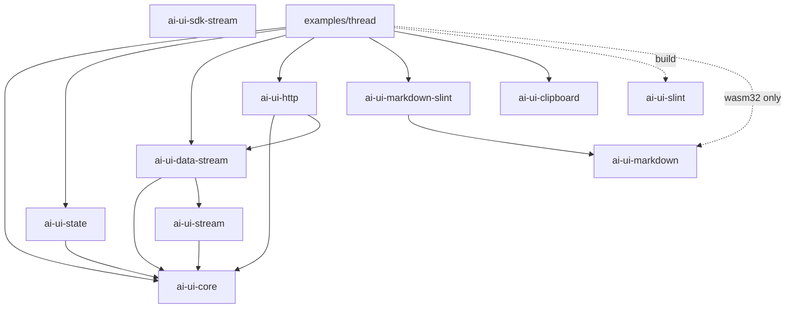

# Crate reference

**What this page gives you.** This page lists every crate in the workspace with its purpose, key types, features, wasm32 support, publishing status and a short example, plus a table for choosing which crates to depend on.

The workspace has ten library crates and one example application. Names below were checked against each crate's `lib.rs` and its compiled rustdoc. For the narrative, start with [Concepts](02-concepts.md); for the layering rationale, see [ARCHITECTURE](../ARCHITECTURE.md).

## Dependency graph

Built from the `Cargo.toml` files (an arrow points from a crate to a crate it depends on):



`ai-ui-core`, `ai-ui-sdk-stream`, `ai-ui-markdown`, `ai-ui-clipboard` and `ai-ui-slint` depend on no other workspace crate. `ai-ui-sdk-stream` depends only on `serde_json`.

## Status at a glance

| Crate | wasm32 | Checked by | Publishing |
|---|---|---|---|
| `ai-ui-core` | yes | gate, CI | no `publish = false`; `cargo package` verified in CI |
| `ai-ui-stream` | yes | gate, CI | no `publish = false`; `cargo package --list` in CI |
| `ai-ui-sdk-stream` | yes | gate, CI | no `publish = false` |
| `ai-ui-data-stream` | yes | gate, CI | no `publish = false`; `cargo package --list` in CI |
| `ai-ui-http` | yes (`FetchClient`) | gate, CI | no `publish = false`; `cargo package --list` in CI |
| `ai-ui-state` | yes | gate, CI | no `publish = false`; `cargo package --list` in CI |
| `ai-ui-markdown` | yes, without the thread-based modules | gate, CI | no `publish = false`; `cargo package` verified in CI |
| `ai-ui-clipboard` | yes (`navigator.clipboard`) | gate (`scripts/gate.sh`) | no `publish = false`; `cargo package` verified in CI |
| `ai-ui-markdown-slint` | only inside the example | demo build | `publish = false` |
| `ai-ui-slint` | no Rust code to compile; Slint sources only | demo build | `publish = false` |

"gate" means `scripts/gate.sh` builds the crate with `--target wasm32-unknown-unknown`. "CI" means the `wasm` job in `.github/workflows/ci.yml` does too; that job does not list `ai-ui-clipboard` today, the local gate does. The Slint crates reach wasm32 through `examples/thread`, which `scripts/build-web-demo.sh` builds ([web guide](05-web.md)).

None of the library crates defines Cargo features. Platform differences are `cfg(target_arch)` and `cfg(target_os)` switches, not flags. The only feature in the workspace is `gpu-window` on the example. This guide does not assume the crates are on crates.io; depend on them by path or Git.

Minimum Rust versions in the manifests: workspace default 1.85, `ai-ui-clipboard` 1.86, `ai-ui-markdown` 1.88, both Slint-facing crates 1.92.

## ai-ui-core

The Rust port of `@assistant-ui/core`: the message model, the branching message repository, the model adapter contract and the runtimes. Depends only on `serde`, `serde_json` and `futures-core`.

Key items:

- `ThreadMessage` (with `UserMessage`, `AssistantMessage`, `SystemMessage`) and the part types (`TextPart`, `ReasoningPart`, `ToolCallPart`, `SourcePart`, and so on). The JSON shape matches upstream, and fields the port does not model round-trip through `extra`.
- `MessageRepository`: the branch tree with a selected path, export/import and `MessageChanges`, the bounded journal views use to read only what changed.
- `ChatModelAdapter`: `fn run(&self, ChatModelRunOptions) -> RunStream`, a stream of cumulative `ChatModelRunResult`s. A closure with that signature works. `adapter::once` and `adapter::from_results` build streams for tests.
- `ThreadRuntime`: the trait UIs bind to. `LocalThreadRuntime` implements it with append, run loop, cancel, branches, tool results and human tools; `ExternalStoreRuntime` implements it over an `ExternalStore` you own.
- `ThreadList` with a `ThreadListAdapter`: list, rename, archive, delete, titles; optimistic changes roll back on failure.
- `SmoothText` / `SmoothOptions`: the smooth-streaming reveal.
- `AbortController` / `AbortSignal`, `Subscription` (drop to unsubscribe), `ToolRegistry` / `Tool`.

The runtime is single-threaded (`Rc`) and executor-agnostic: methods do their synchronous work at once and return a `RunFuture` that you spawn. There is no ambient clock or randomness, which is why the crate builds for wasm32.

```rust,ignore
use ai_ui_core::{adapter, AppendMessage, ChatModelRunResult, LocalRuntimeOptions, LocalThreadRuntime, ThreadRuntime};

let runtime = LocalThreadRuntime::new(
    |_options| adapter::from_results([Ok(ChatModelRunResult::text("Hello!"))]),
    LocalRuntimeOptions::default(),
);
let run = runtime.append(AppendMessage::user_text(None, "Hi")).unwrap();
futures_executor::block_on(run).unwrap();
assert_eq!(runtime.messages().last().unwrap().text(), "Hello!");
```

Compiled and run against this checkout by hand; the same example is a doctest in the crate.

## ai-ui-stream

The port of `assistant-stream`: typed chunks, the accumulator that folds them into an assistant message, partial JSON for tool arguments, and the `assistant-transport` SSE serialization. Depends on `ai-ui-core`.

Key items:

- `Chunk` / `ChunkKind` / `PartInit` / `FinishReason`: the typed stream events.
- `MessageAccumulator` (with `AccumulatorLimits`): `push(chunk)`, `result()` for the cumulative `ChatModelRunResult`, `finish()`, `status()`, `warnings()`.
- `StreamDecoder`: the trait a wire format implements. Provided: `SseDecoder` (assistant-transport), `DataStreamDecoder` (AI SDK data stream) and `UiMessageStreamDecoder` (AI SDK UI message stream).
- `run_stream` and `run_stream_from_sse`: turn a response byte stream into a `RunStream` for an adapter. Slices that are ready are folded into one result per wake-up.
- Modules `partial_json` and `state` (state operations) for the pieces behind it.

```rust,ignore
use ai_ui_stream::{run_stream_from_sse, MessageAccumulator};
use ai_ui_core::RunStream;

// `bytes` is any futures Stream of Result<Vec<u8>, E> where E: Display.
fn adapter_stream(bytes: impl futures_core::Stream<Item = Result<Vec<u8>, String>> + 'static) -> RunStream {
    run_stream_from_sse(bytes, MessageAccumulator::default())
}
```

Compiled against this checkout.

## ai-ui-sdk-stream

A bounded, incremental fold of the AI SDK 7 UI message stream (`x-vercel-ai-ui-message-stream: v1`) into messages. It depends only on `serde_json`, forbids unsafe code, denies `unwrap`/`expect`/`panic` in its sources, and is checked by a differential test against the published AI SDK. The header names a wire format, not an SDK major version. Legacy data-stream and assistant-transport adapters are not part of this crate.

Key items:

- `Runtime`: the single-owner engine. `Runtime::new(message_id, Config)`, `ticket()`, `push(ticket, bytes, observe)`, `end(ticket)`, `cancel(ticket)`, `restart(message)`, `view()`.
- `RunTicket`: a run's identity. Feeding with a stale ticket returns `FeedOutcome::IgnoredStale` without parsing.
- `Delivery` and `MessageView`: what `push` hands your callback. The view is borrowed, so the ordinary delta path never clones the message; call `snapshot()` only when you need an owned JSON value.
- `Config` / `Limits` (`event_bytes`, `run_bytes`, `parts`), `UnknownPolicy`, `ServerErrorPolicy`.
- `UiReducer`, `Update`, `ApplyResult`, `StreamError`.

Limits are this crate's policy, not upstream protocol limits, and oversized input fails explicitly rather than truncating.

```rust,ignore
use ai_ui_sdk_stream::{Config, Runtime};

let mut runtime = Runtime::new("msg-1", Config::default()).unwrap();
let ticket = runtime.ticket();
let wire = b"data: {\"type\":\"start\",\"messageId\":\"msg-1\"}\n\n\
             data: {\"type\":\"text-start\",\"id\":\"t\"}\n\n\
             data: {\"type\":\"text-delta\",\"id\":\"t\",\"delta\":\"Hi\"}\n\n";
runtime
    .push(ticket, wire, |delivery| {
        let _parts = delivery.view.part_count();
    })
    .unwrap();
println!("{}", runtime.view().snapshot());
```

Compiled and run against this checkout; it prints a message with one streaming text part containing `Hi`.

## ai-ui-data-stream

The port of `@assistant-ui/react-data-stream`: a `ChatModelAdapter` for AI SDK backends. It sends upstream's request body and reads either a UI message stream or a data stream, detected from the AI SDK response headers. Depends on `ai-ui-core` and `ai-ui-stream`.

Key items:

- `DataStreamAdapter<C>` and `DataStreamOptions`: `DataStreamOptions::new(api)` with optional `headers` and `body` closures evaluated per request and an explicit `protocol`.
- `HttpClient`: one method, `post(HttpRequest, AbortSignal) -> ResponseFuture`. Implement it for your own HTTP stack.
- `HttpRequest`, `HttpResponse` (`header(name)`), `HttpError`, `ByteStream`.
- `Protocol` and `resolve_protocol`.
- `request_body`, `to_model_messages` and `to_language_model_messages`: the request-body pieces, public so you can build your own transport.

```rust,ignore
use ai_ui_core::{LocalRuntimeOptions, LocalThreadRuntime};
use ai_ui_data_stream::{DataStreamAdapter, DataStreamOptions};

let adapter = DataStreamAdapter::new(my_http_client, DataStreamOptions::new("https://example.com/api/chat"));
let runtime = LocalThreadRuntime::new(adapter, LocalRuntimeOptions::default());
```

The ready-made clients are in `ai-ui-http`; the example in the next section compiles.

## ai-ui-http

Ready-made `HttpClient` implementations. Depends on `ai-ui-core` and `ai-ui-data-stream`, plus target-specific dependencies: `ureq` with rustls off wasm32, and `wasm-bindgen`, `web-sys` and friends on wasm32.

Key items:

- `NativeClient` (not wasm32): `NativeClient::new()` or `NativeClient::with_agent(ureq::Agent)`. One worker thread per request.
- `FetchClient` (wasm32 only): browser `fetch`, `credentials: same-origin` by default, with `include_credentials: bool` for cross-origin cookies. Dropping the response body aborts the request.

The two never exist in the same build, so write code that picks the client with `cfg(target_arch = "wasm32")`.

```rust,ignore
use ai_ui_core::{LocalRuntimeOptions, LocalThreadRuntime};
use ai_ui_data_stream::{DataStreamAdapter, DataStreamOptions};
use ai_ui_http::NativeClient;

let adapter = DataStreamAdapter::new(
    NativeClient::new(),
    DataStreamOptions::new("https://example.com/api/chat"),
);
let runtime = LocalThreadRuntime::new(adapter, LocalRuntimeOptions::default());
```

Compiled against this checkout (it does not connect to anything). On wasm32, replace `NativeClient::new()` with `FetchClient::default()`. A Chromium smoke test (`crates/ai-ui-http/tests/browser/run.py`) exercises `FetchClient`.

## ai-ui-state

The UI-agnostic state layer, after upstream's scoped state. A UI renders `ThreadState` from a `ThreadView` and calls the view's actions, whatever toolkit it uses and whichever runtime sits below. Depends on `ai-ui-core`.

Key items:

- `ThreadView`: `new(runtime, ViewOptions)`, `for_list(&ThreadList, ..)`, `subscribe(callback)`, `state() -> Arc<ThreadState>`, `rebind(runtime)`, `tick(now_ms)` and `needs_frame()` for smooth-streaming animation.
- Actions on the view: `send`, `stop`, `reload`, `switch_branch`, `begin_edit`, `edit_composer`, `copy_text`, `mark_copied`, `toggle_part`, `respond_to_approval`, `add_tool_result`, `submit_feedback`.
- `ThreadState` (`messages: Vec<Arc<MessageState>>`, `is_empty`, `is_running`, `capabilities`) and `MessageState` with `PartState`.
- `PartKind`: `Text`, `Reasoning`, `ToolCall`, `Source`, `Image`, and the other part kinds.
- `ToolCallState`, `ToolStatus`, `ToolPresentation`, `ApprovalState`, `ApprovalDecision`.
- A row cache keyed by `Arc` identity: a message that did not change keeps its `Arc`, which is how the example decides which Slint rows to rebuild. The clock is supplied by the caller (`tick(now_ms)`, `mark_copied(id, now_ms)`).

```rust,ignore
use ai_ui_core::{adapter, ChatModelRunResult, LocalRuntimeOptions, LocalThreadRuntime};
use ai_ui_state::{ThreadView, ViewOptions};
use std::rc::Rc;

let runtime = LocalThreadRuntime::new(
    |_options| adapter::from_results([Ok(ChatModelRunResult::text("Hello!"))]),
    LocalRuntimeOptions::default(),
);
let view = ThreadView::new(Rc::new(runtime), ViewOptions { smooth: None });
let _subscription = view.subscribe(|| println!("changed"));
let run = view.send("Hi").unwrap().unwrap();
futures_executor::block_on(run).unwrap();
assert_eq!(view.state().messages.len(), 2);
```

Compiled and run against this checkout. Drop the returned `Subscription` to unsubscribe.

## ai-ui-markdown

The port of `@assistant-ui/markdown`: a bounded, safe parser and block projection for streaming chat text. Dependencies: `pulldown-cmark`, `url`, `serde`. It never fetches images, opens links, renders HTML or performs I/O; those are inert data, and links need an explicit host action.

Key items:

- `parse(source) -> Result<Document, ParseError>` with `Document`, `Block`, `Inline`, `Alignment`. Hard limits `MAX_SOURCE_BYTES` (1 MiB), `MAX_EVENTS`, `MAX_NESTING`, `MAX_OUTPUT_BYTES` fail with an error, never a silent truncation.
- `presentation::project(source)`: the UI-independent projection into `RenderBlock`s, plus `safe_destination` for link targets.
- `split::StreamSplit` and `split::top_level_blocks`: settled blocks versus the live tail for streaming text.
- `scheduling::Scheduler`: coalesces snapshots and tracks revisions.
- Native only: `coordinator::Coordinator` (a latest-snapshot worker), `pool::CoordinatorPool` (several coordinators sharded by key; `default_workers()`, at most `MAX_WORKERS` = 8) and `worker::Worker`.

On wasm32 the thread-based modules are compiled out; the browser demo runs `project` inline.

```rust,ignore
use ai_ui_markdown::{parse, split::StreamSplit};

let document = parse("# Title\n\nSome **bold** text.").unwrap();
assert_eq!(document.blocks.len(), 2);

// While text streams, settled blocks are formatted once and only the tail again.
let mut split = StreamSplit::new();
let (settled, tail) = split.update("one\n\ntwo\n\nthree\n\nfo");
println!("{} settled blocks, live tail {} bytes", settled.len(), tail.len());
```

Compiled and run against this checkout.

## ai-ui-markdown-slint

Converts the portable Markdown presentation into Slint records and manages the UI-thread cache. `publish = false`. Depends on `ai-ui-markdown` and Slint (`=1.18.1`, default features off).

Key items:

- `Factory`: you implement `cell` and `block` to map the shared `Block<C>` / `BlockKind` / `Alignment` into the record types your own `.slint` generates.
- `convert` and `literal`: build blocks from a presentation, or from literal source with a warning when formatting is unavailable. Run them on the Slint thread.
- `cache::Cache`, `cache::Backend` (nonblocking executor contract), `cache::Limits`, `cache::NativeBackend` (a worker pool; not on wasm32).
- `streaming::StreamingCache<K, F, B>`: `observe_one(key, text, streaming)`, `poll()`, `take_changed()`, `view(key, source, streaming)`, `retain(keep)`, `has_pending()`. Each settled block is a cache entry of its own.

```rust,ignore
use ai_ui_markdown_slint::{cache::{Limits, NativeBackend}, streaming::StreamingCache};

let backend = NativeBackend::start(2048, 256 * 1024).ok();
let mut markdown = StreamingCache::new(
    MyFactory, // your `Factory` implementation
    backend,
    Limits { keys: 2048, presentation_units: 8 * 1024 * 1024 },
);
markdown.observe_one((message_id, part_index), &text, still_streaming);
// On a timer: if markdown.poll() { for key in markdown.take_changed() { /* refresh that row */ } }
```

Fenced as `ignore` because it needs your generated Slint types; `examples/thread/src/markdown.rs` is the compiling version.

## ai-ui-slint

The Slint component library: thread, messages, composer, branch picker, action bar, reasoning and tool disclosures, thread list, settings menu and Markdown blocks. `publish = false`, no Cargo dependencies, `#![forbid(unsafe_code)]`. The Rust API is one function; everything else is `.slint` under `ui/`, listed in [Building a UI with Slint](04-ui-slint.md).

Key items:

- `ai_ui_slint::ui_dir() -> PathBuf`: the folder containing `lib.slint`, for the consuming build script. Use it at build time only.
- From `lib.slint`: `AssistantThread`, `AssistantComposer`, `AssistantMarkdown`, `AssistantThreadList`, `AssistantSettingsMenu`, `AssistantApproval`, `AssistantBranchPicker`, `AssistantTheme` and the records `ChatRow` and `ChatPart`.
- Its dev-dependency on Slint is for offscreen component tests; consumers pick their own backend and renderer.

```rust,ignore
// build.rs
let libraries = std::collections::HashMap::from([("assistant".to_string(), ai_ui_slint::ui_dir())]);
let config = slint_build::CompilerConfiguration::new().with_library_paths(libraries);
slint_build::compile_with_config("ui/app.slint", config).unwrap();
```

## ai-ui-clipboard

Host-owned clipboard text operations that report whether the copy worked. No Slint or conversation-state dependency. On Linux, Windows and macOS it uses `arboard` (with Wayland data control) on a bounded worker thread; on `wasm32-unknown-unknown` it uses `navigator.clipboard`.

Key items:

- `Clipboard::new()`, `copy(text, completion)`, `read_text(completion)`, `shutdown()`. Dropping the handle also shuts it down.
- `Completion`: a boxed `FnOnce(Result<(), CopyError>) + Send`. `ReadCompletion` is the same for reads.
- `CopyError`: `TooLarge`, `Unavailable`, `Busy`, `Rejected`, `Cancelled`, `WorkerStopped`. `ReadError` is its read counterpart. Errors never contain clipboard content.
- `MAX_COPY_BYTES` (1 MiB) and `MAX_READ_BYTES` (4 MiB).

On native, the completion runs on the worker, so dispatch UI updates back to the UI thread. In the browser, call `copy` synchronously inside the user gesture.

```rust,ignore
use ai_ui_clipboard::{Clipboard, CopyError};

if let Ok(clipboard) = Clipboard::new() {
    let _ = clipboard.copy(
        "hello".to_string(),
        Box::new(|result: Result<(), CopyError>| {
            if let Err(error) = result {
                eprintln!("copy failed: {error}");
            }
        }),
    );
}
```

Compiled against this checkout (not run: running it writes to the system clipboard).

## Choosing crates

| You want | Use |
|---|---|
| A runtime and tools, no UI | `ai-ui-core` |
| A backend that speaks the AI SDK protocols | `ai-ui-core` + `ai-ui-data-stream` + `ai-ui-http` |
| A custom transport | `ai-ui-core` + `ai-ui-stream` (assistant-transport) or `ai-ui-sdk-stream` (AI SDK 7 UI messages, standalone) |
| State for your own UI toolkit | the above + `ai-ui-state` |
| Markdown in your own renderer | `ai-ui-markdown` |
| The Slint thread UI | all of the above + `ai-ui-markdown-slint` + `ai-ui-slint`; see [the Slint guide](04-ui-slint.md) |

Next: [Performance](07-performance.md) for the measured results, or [Coming from assistant-ui](08-from-assistant-ui.md) for the parity table.
